<picture>
  <source media="(prefers-color-scheme: dark)" srcset="docs/brand/lockup-dark.svg">
  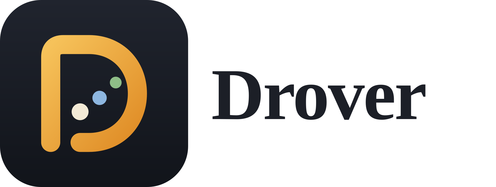
</picture>

# Drover

A control plane for every coding agent you run, on every machine you run them on. Drover sees the Claude Code
sessions, Codex threads, Grok bots and its own OpenClaw fleet manager on all your hosts, shows what each one is doing
and which ones are waiting on you, and lets you answer them, message them and launch new ones from a browser, a
terminal, a Mac, an iPhone, a watch or a browser extension. It also keeps one append-only truth file of features,
notes, messages and launches. One daemon per machine, zero npm dependencies, Node 24. Machines reach each other over
ssh, with no open ports.

<picture>
  <source media="(prefers-color-scheme: dark)" srcset="docs/screenshots/web-board-dark.png">
  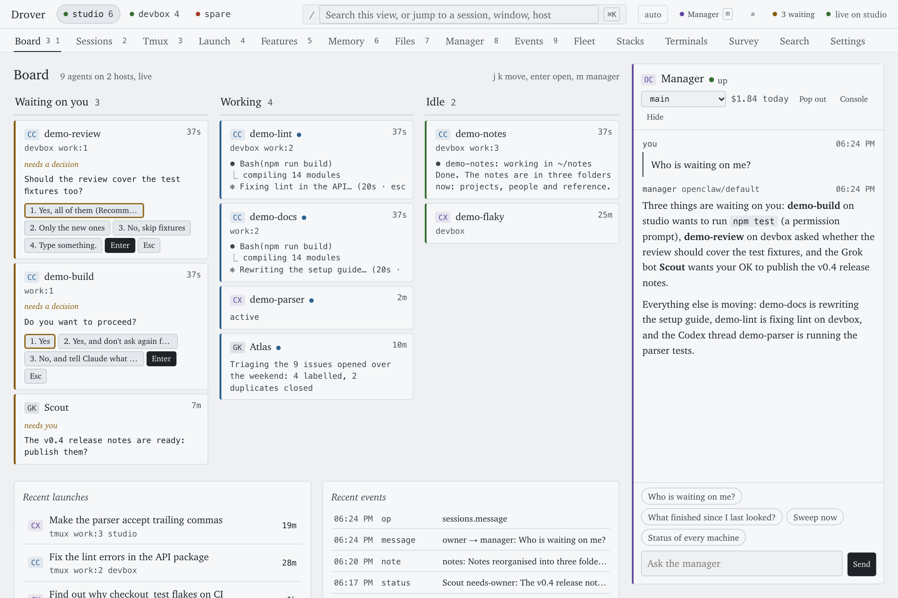
</picture>

## The agents it drives

| Agent | How Drover reaches it | What you can do |
|---|---|---|
| **Claude Code** | Interactive sessions in tmux (the session registry, the transcript, the pane) and headless `claude -p` runs it holds open | Read the chat with every tool call and result, answer a permission dialog or a question with one key, message the session's inbox, launch a new one under any profile and effort |
| **Codex** | Threads through `codex app-server`, transcripts from the rollout files | Read the thread, message a TUI thread (`codex queue`) or a headless one, launch new ones at any reasoning effort |
| **Grok bots** | Grok Bot agents on xAI's hosted VMs connect through Drover's bot gateway (OAuth and MCP); each bot is a session, `grok:<name>` | Send a bot work through its Routine webhook, read its replies and status reports, see it in the waiting lane when it needs you |
| **OpenClaw** | Drover installs an OpenClaw agent as the fleet manager (`drover manager setup`) | Ask it about the whole fleet ("who is waiting on me?") from any client, have it sweep every host, float it over any tmux window |
| **Any tmux pane** | `tmux` on each host | Read the screen, send keys and text; a paste into a pane that shows a dialog is refused unless you force it |

Hermes Agent and other harnesses are not supported yet.

Around those agents:

- **The board**: every live agent on every host in three lanes (waiting on you, working, idle), with the dialog an agent
  shows as buttons you can press, and alerts in the browser, on the Mac, on the phone and on the watch.
- **Launch**: start Claude Code or Codex on any host, in a tmux window or headless, with a profile, a model, an effort
  level and a prompt; folders are trusted for you so the agent does not stop at its first-run question.
- **The truth file**: features, notes, pins, handoffs, messages and launches, appended by people and agents alike, synced
  with your dotfiles. The board, the Features view and the manager read it.
- **MCP**: `drover mcp` gives Claude Code and Codex the same powers as the UI (the `drover_*` tools), so one agent can
  read, message and launch the others.
- **Search**: what was said in every session on every machine, by meaning and by exact words (`drover search`,
  `drover grep`), with a local embedding model.
- **Docker stacks**: every compose stack on every host, which services are failing and why, and the code each one runs
  (branch, commit, dirty files, images older than the source).
- **Vitals and placement**: memory, swap, disk and CPU per host, with alerts, and a placement op that says which host
  has room for one more agent.

## The clients

### Web UI

The daemon serves it. The board above; a session's drawer with its chat, screen and info; the manager in a dock or a
window of its own; and views for sessions, tmux, launches, features, memory, files, events, the fleet, stacks,
terminals and search.

<p>
  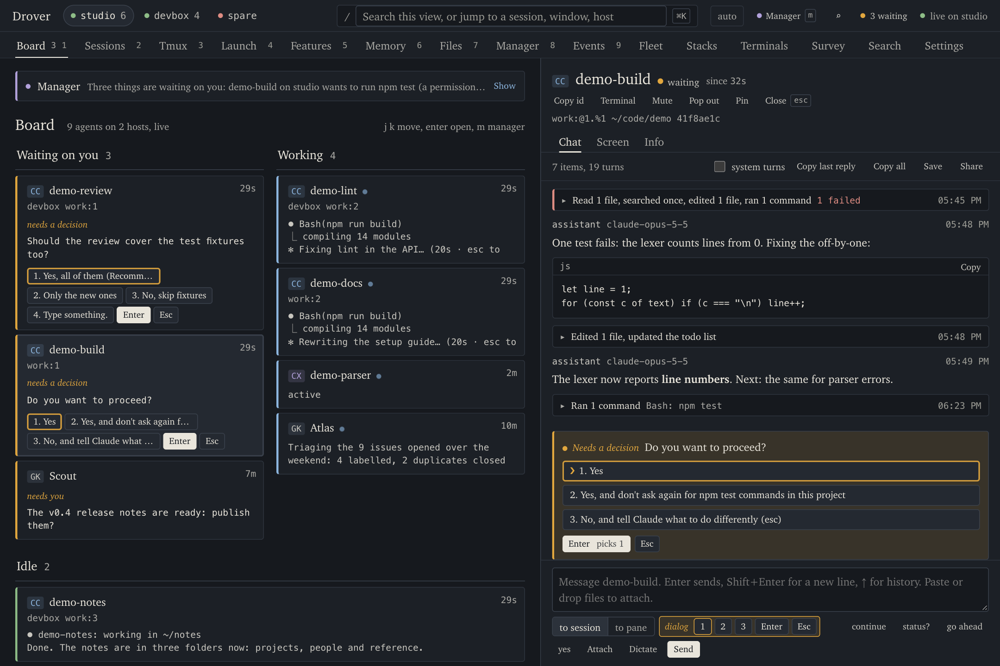
  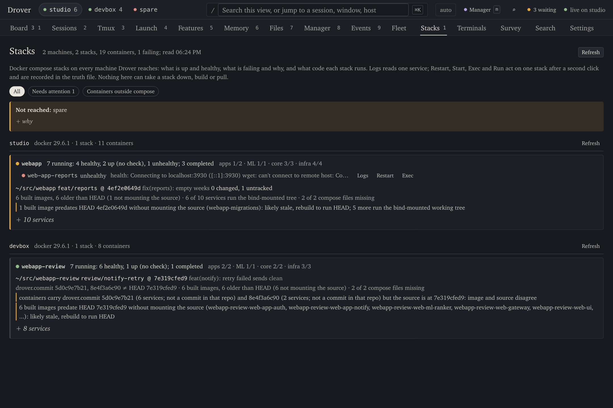
</p>
<p>
  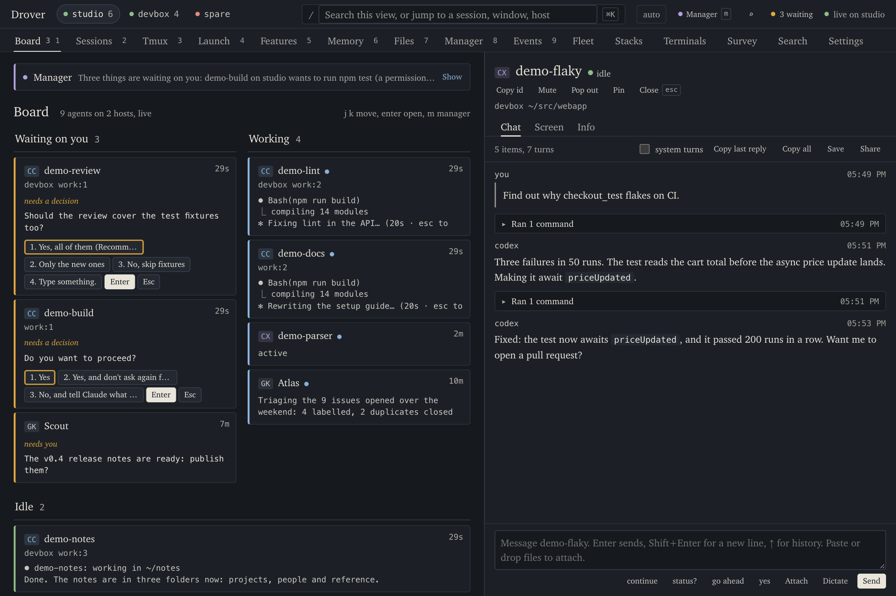
  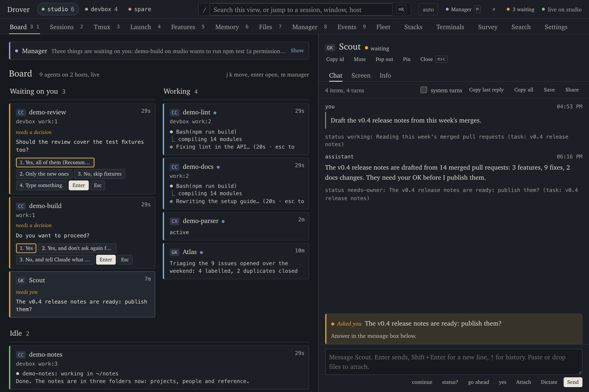
</p>

### Terminal UI and CLI

`drover tui` opens on the manager, then the board, sessions and every web view as tables. `drover` itself runs any
op (`drover op sessions.list`), searches every transcript, and lists the docker stacks on every host.

<p>
  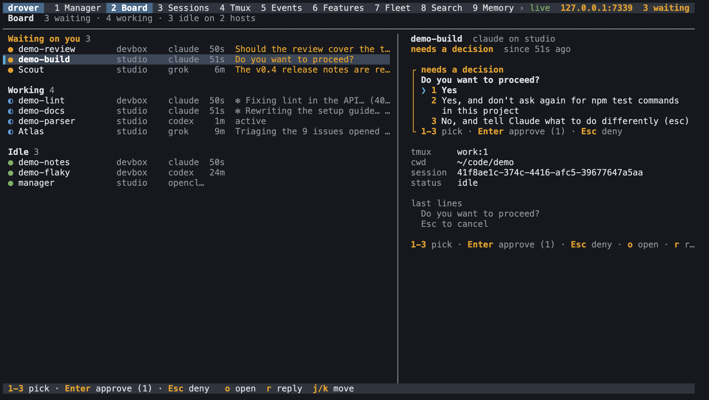
  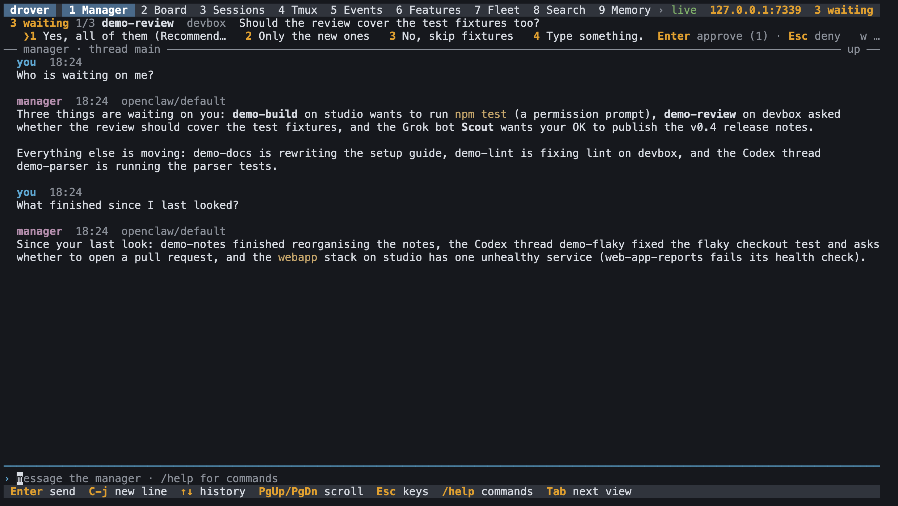
</p>
<p>
  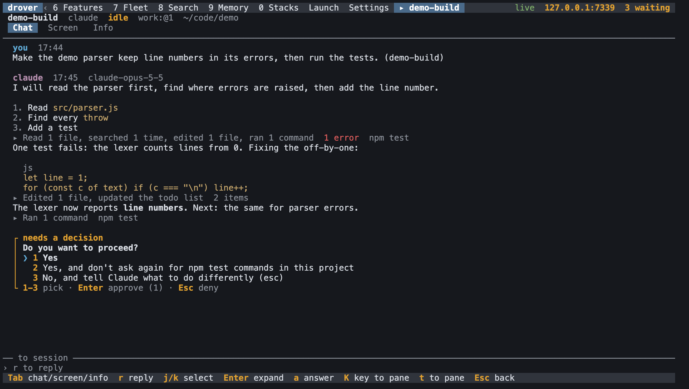
  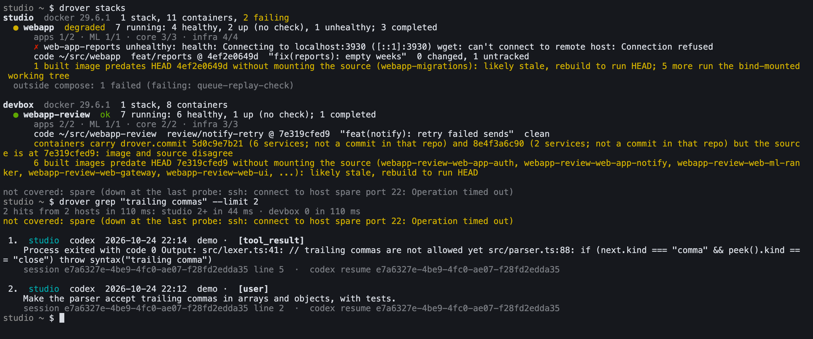
</p>

### Mac app, menu bar and widgets

A native Mac app (board, chat, screen, the manager, a command palette), a menu bar app that answers dialogs from the
menu bar, and widgets for the Mac desktop and the iPhone home screen (plus lock screen and watch complications). The
apps pair with the daemon by a six-digit code.

<picture>
  <source media="(prefers-color-scheme: dark)" srcset="docs/screenshots/mac-board-dark.png">
  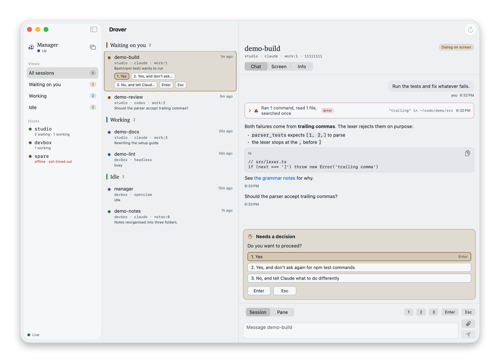
</picture>

<p>
  <picture>
    <source media="(prefers-color-scheme: dark)" srcset="docs/screenshots/menubar-dark.png">
    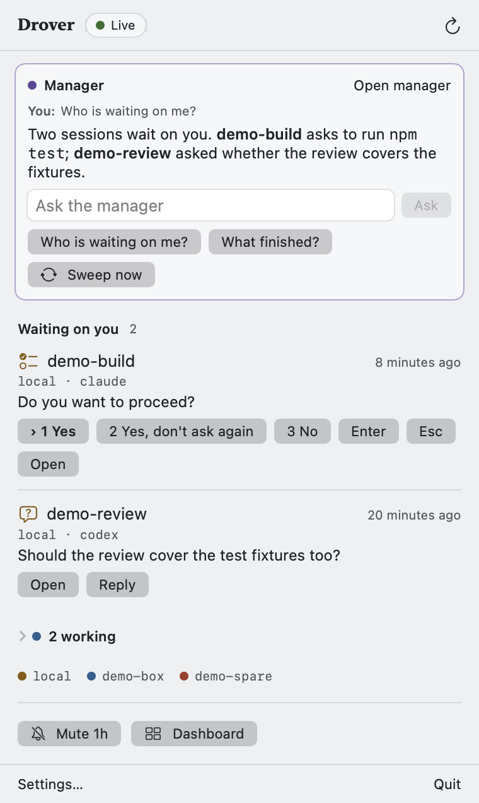
  </picture>
  <picture>
    <source media="(prefers-color-scheme: dark)" srcset="docs/screenshots/widgets-dark.png">
    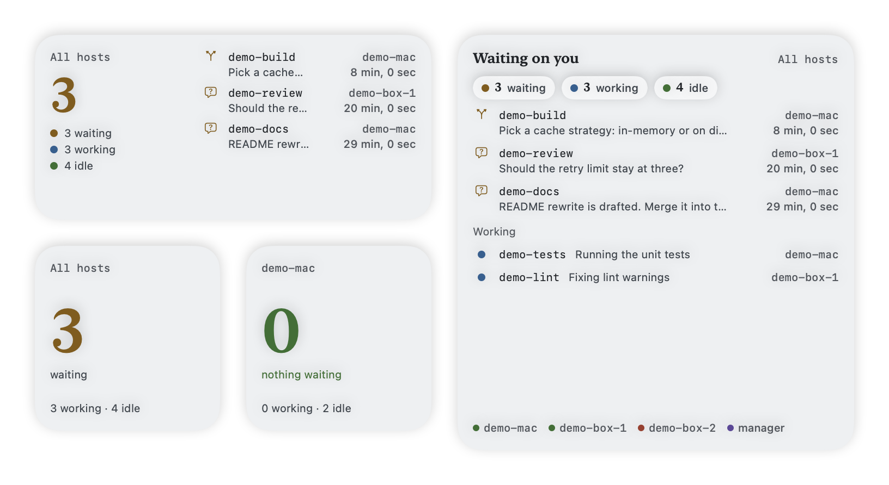
  </picture>
</p>

### iPhone and Apple Watch

The iPhone app has the board, every session's chat and screen with the dialog's keys, the manager, and notifications
you can reply to from the lock screen. The watch app lists what is waiting on you, buzzes when something new is, and
answers with a canned reply (yes, no, continue, go ahead, status?) or by dictation. Both work over a tailnet.

<p>
  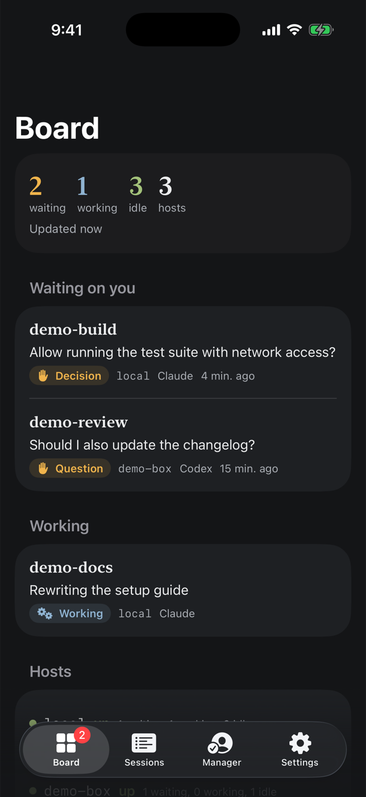
  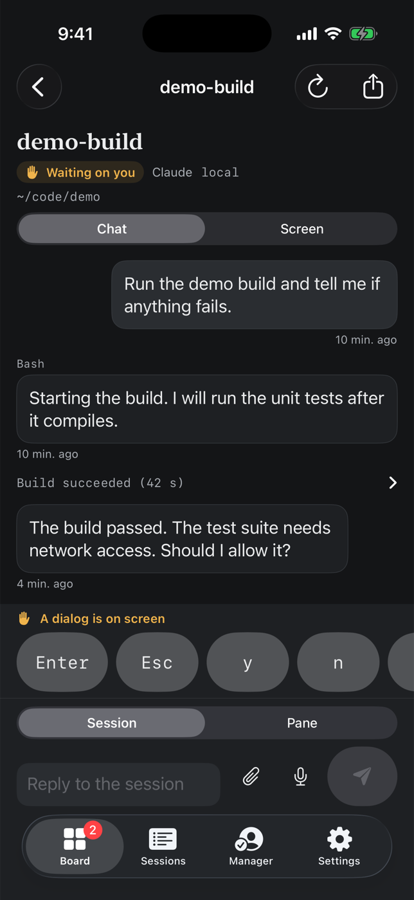
  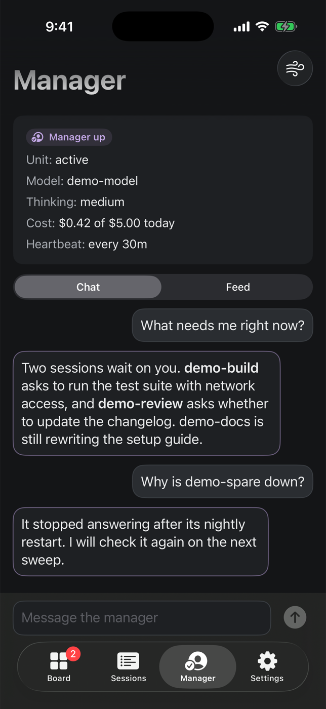
  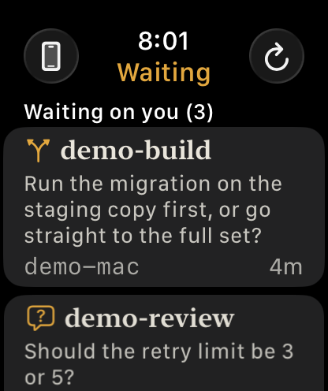
  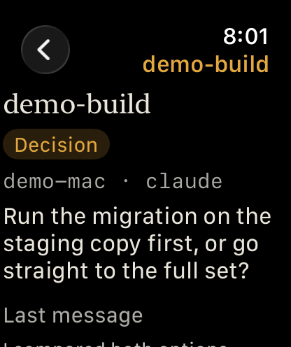
</p>

### Chrome and Safari extensions

The toolbar popup asks the manager and answers waiting agents; the side panel follows one session's chat. The Safari
extension is the same code (built from the Chrome extension with a small shim), embedded in the Mac and iPhone apps,
so the pictures below stand for both.

<p>
  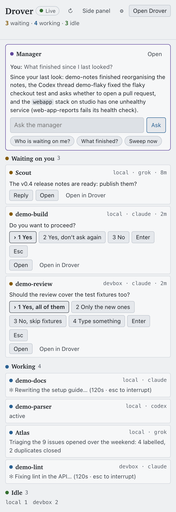
  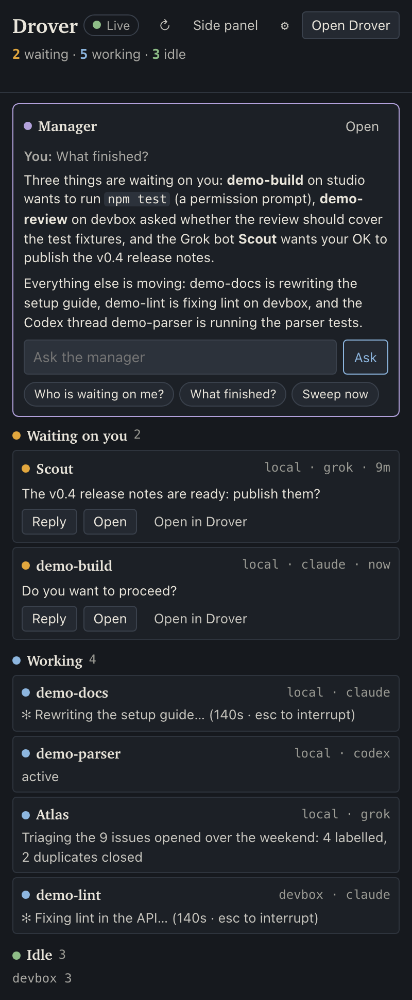
  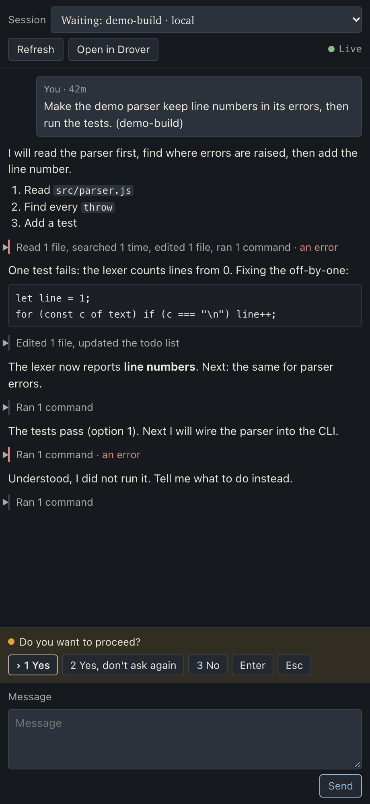
</p>

Every picture is of synthetic data: the showcase world (`web/test/devworld.js --showcase`), three pretend hosts and
every engine on this machine alone, for the web UI, the terminal and the extensions, and each Apple app's own mock
data. How to make them again: [docs/screenshots/README.md](docs/screenshots/README.md).

## Repository

| path | what |
|---|---|
| `web/` | Drover: the per-machine daemon (`drover`), its op table, the browser UI, the terminal UI, the `drover_*` MCP server, the bot gateway, the OpenClaw fleet manager. Tests: `cd web && node --test test/*.test.js` |
| `native/` | Native clients over the daemon's HTTP API (`native/CONTRACT.md`): macOS app, menu bar app, iOS, watchOS, widgets, Chrome and Safari extensions |
| `skills/` | Agent skills: `drover` (the tools and how to use them) and `drover-manager` (the manager popup) |
| `integrations/` | The skill a Grok bot uses through the bot gateway |
| `docs/` | The brand marks and the screenshots |

## Install

On each machine (macOS or Linux, Node 24 on PATH, tmux):

```
git clone https://github.com/coletebou/drover ~/code/drover
ln -s ~/code/drover/web/bin/drover ~/.local/bin/drover
drover serve                       # foreground; then keep it running under launchd (Mac) or a systemd user unit (Linux)
drover open                        # the browser UI, with its token
claude mcp add --scope user drover -- node ~/code/drover/web/bin/drover mcp   # the drover_* tools (web/mcp/REGISTER.md)
```

Other machines are ssh-config aliases with Drover at `~/.local/bin/drover`: the ones listed in
`$DROVER_DOTFILES/claude/fleet-hosts.txt` (one name a line) are the fleet the UI shows, and any other alias in
`~/.ssh/config` is a target you can name (`drover op host.list`). `DROVER_DOTFILES` (default `~/.dotfiles`) is a git
repository you sync between machines: it also holds the truth file, `claude/drover-events.jsonl` (append-only, mark it
`merge=union` in `.gitattributes`). The fleet manager is `drover manager setup --scope local` on the host that should
run it (`web/openclaw-manager/README.md`), the Grok bot gateway is `web/README.md`, "Grok bots", and the native apps
build from `native/` (`native/README.md`). Everything else, from the HTTPS front for phones to pairing devices, is in
`web/README.md`.

## Plugins and settings

Integrations only one fleet needs (a private forge, a deploy pipeline, a memory service, hosts reached some other way
than ssh) are plugins: directories with a `plugin.js` that add ops, MCP tools, UI views and TUI tables, loaded from
`DROVER_PLUGINS` or `~/.config/drover/plugins/`. A fleet's non-secret settings (the owner's name, a default repo,
launch profiles, docker labels) are `KEY=value` lines in `~/.config/drover/*.env`. Both usually live in that fleet's
own private repository, linked in. See `web/README.md`, "Plugins" and "Settings files".

Drover was named apx / apx-web (CLI `apxw`) until 2026-10-15. The `apxw` shim, the `APXW_*` variable fallbacks and the
import from `claude/apx-events.jsonl` stay until 2026-11-15; see `web/README.md` for what moved where.

## CI

`.github/workflows/build.yml`, on every push and pull request: the web and extension tests (Node 24, with tmux for the
real-tmux tests) and the portable DroverKit tests (Swift 6.4), plus unsigned Xcode builds of every scheme. On a public
repository the Linux jobs run on hosted Ubuntu (DroverKit in the `swift:6.4.1-noble` container); on a private one, on
the self-hosted ARM Linux runners labelled `drover` (Swift in `/opt/swift`, tmux installed), because hosted minutes are
billed there. `signed.yml` (manual): Developer ID + notarized Mac apps as an
artifact, and TestFlight uploads, in the environment `signing`; needs variable `DROVER_TEAM_ID`, secrets `ASC_KEY_ID`,
`ASC_ISSUER_ID`, `ASC_KEY_P8` and the `.p12` certificates listed in the workflow (environment values override
repository ones). `screenshots.yml` (manual, and on pushes to `screenshots/**`): the iPhone and watch pictures from
the simulators, as an artifact.

Hosted macOS is free on a public repository and billed at 10x on a private one. On a public repository both macOS jobs
run on `macos-15` (give `signing` a required reviewer and limit it to master). On a private one they run only on a
self-hosted Mac with the label `drover-mac` once the repository variable `DROVER_MAC_RUNNER` is `on`
(`gh variable set DROVER_MAC_RUNNER --body on`), unsigned builds on `master` and manual runs only;
until then they are skipped, not queued. A self-hosted runner is never used on a public repository, so a pull request
from a fork never runs on one of our machines. Actions are pinned by commit SHA and kept current by Dependabot.

## License

Copyright 2026 Cole Tebou. Licensed under the [Apache License, Version 2.0](LICENSE); see also [NOTICE](NOTICE).
Contributions are accepted under the same license (section 5).
